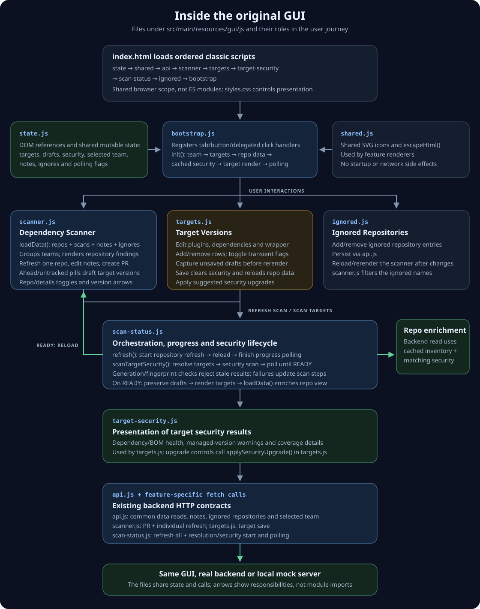
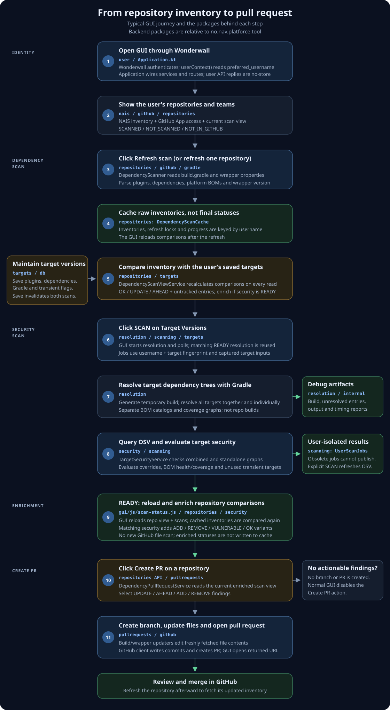

# platforce-tool 
Selfservice console for operating on Salesforce middleware apps

## Code structure

`Application.kt` constructs services and composes routes; `Bootstrap.kt` is the
entry point. Feature code lives under `src/main/kotlin/no/nav/platforce/tool`:

| Package | Responsibility |
| --- | --- |
| `repositories` | Repo inventory, comparisons, scanner views, cache and API |
| `targets` | Target defaults, state, persistence, fingerprints and API |
| `resolution` | Gradle project generation, execution, results, timings and debug files |
| `security` | OSV integration, target security evaluation, scan results and API |
| `pullrequests` | Build/wrapper updates and GitHub PR orchestration |
| `gradle` | Build and wrapper file parsing |
| `nais`, `github` | External clients and GitHub App authentication |
| `scanning` | Shared user-isolated asynchronous scan jobs |
| `user`, `notes`, `ignore` | User context, selected team, notes and ignored repos |
| `internal`, `config`, `db` | Operational routes, configuration and database tables |

Services receive collaborators explicitly rather than accessing a global
Application instance. Domain and API model classes live alongside their feature.
Cross-feature regression scenarios and test doubles live in `src/test/kotlin`
under `workflows`; focused client, route and view tests use matching packages.

Frontend features live in `resources/gui/js`: `api`, `state`, `shared`, `scanner`,
`targets`, `target-security`, `scan-status`, `ignored` and `bootstrap`. `index.html`
loads these as ordered classic scripts, sharing state and preserving existing
inline handlers without a build tool; bootstrap runs last.

### Typical user flow

#### GUI files

The GUI scripts share browser scope. `bootstrap.js` wires interactions and
startup, `state.js` holds shared state, and the feature files own rendering and
user actions. `api.js` contains common requests; scan orchestration, PR creation,
individual refresh and target saving also make requests in their feature files.
The diagram shows responsibilities rather than an ES-module dependency graph.

`styles.css` is grouped into page/navigation, common controls, repository cards,
summary badges, findings/untracked rows, target editing, scan progress, security
details and visibility utilities. Existing rule overrides retain their order.

#### Backend packages

The diagram follows **Refresh scan → Target Versions SCAN → enriched repository
view → Create PR**. Repository inventories are cached per user; comparison and
security enrichment happen on reads, not by rewriting the inventory cache.
Security scanning resolves the saved target dependencies, not each repository's
build. When it completes, the GUI reloads repository data without another
GitHub file scan. PR creation uses that same current comparison/enrichment path.

Saving targets invalidates that user's resolution and security results. A
matching completed Gradle resolution can be reused, while an explicit security
scan refreshes OSV findings. The diagram shows the successful journey; scan
failures are exposed to the GUI and obsolete jobs cannot publish results.

## Application behavior

`/internal/files` retains separate per-user diagnostics for the latest dependency
and BOM resolutions: `build.gradle` and `build-bom.gradle`. BOM output, unresolved
findings, timings and resolution reports use the same `-bom` suffix before their
extension. Starting a fresh run clears only that mode's previous diagnostics;
cached resolution reuse leaves the files unchanged. Publishing these files uses
local copies only, without extra resolution or security scans.

When several missing vulnerability overrides are required, repository enrichment
prefers a target whose scanned individual graph covers multiple requirements.
For example, one jackson-databind ADD can replace separate databind/core ADDs
when its matching safe target version supplies both fixes. Independent overrides
remain separate; the GUI explanation and generated PR use the same selection.
This reuses security-scan evidence without additional Gradle resolutions.

User-marked transient overrides are needed only when they provide actual
vulnerability fixes. A redundant override is marked REMOVE when retained targets
already cover its fixes (for example databind covering core). Repository PRs
remove it only when the replacement dependencies are present at their scanned
versions in matching declaration configurations; otherwise the override stays.

Platform BOMs have a separate target section below Gradle and a separate
repository finding type. Literal `platform(...)` and `enforcedPlatform(...)`
coordinates are discovered as untracked until saved as a target. Click an
UNTRACKED or AHEAD pill to draft the version, then save Target Versions.
Tracked BOMs use the same OK / UPDATE / AHEAD comparisons and PR updates as
other versioned entries.

The regular **SCAN** remains dependency-only. **Scan BOMs**, in the Platform
BOMs header, explicitly opts in to the more expensive analysis of all saved
BOM targets. The two scan modes use separate per-user jobs/results; running
SCAN again does not discard completed, still-matching BOM coverage. Saving
targets invalidates both modes. BOM analysis can also run without dependency
targets.

BOM scans keep the dependency-only individual/collective graphs as the
baseline and analyze each saved BOM separately. Gradle metadata supplies the
complete managed-module catalog (including inherited/imported constraints);
isolated versionless probes select each effective managed version without
resolving its ordinary transitive dependencies. OSV checks these versions even
when no saved dependency uses the module. A red BOM status is therefore a
managed-version warning, not proof that every repository installs that module.
Upgrade the BOM target and rescan; module fixes are not BOM version suggestions.

Separate dependency-plus-BOM graphs show which vulnerable transitive versions a
normal or enforced platform fixes. Repository enrichment omits redundant ADDs
only when dependency/BOM versions match the scanned targets and declarations
share a configuration. This initial coverage proof requires a single platform
declaration: multiple platforms, unknown scope relationships and mismatched
versions retain the existing ADD suggestions rather than assume protection.
Partial coverage retains the remaining ADDs. BOM target health and coverage are
displayed independently; a BOM can fix one used module while managing vulnerable
versions of unused modules elsewhere. Adding a missing BOM instead of multiple
dependency ADDs remains out of scope. These scans analyze supported target
declarations, not arbitrary repository Gradle rules.

### Local mock GUI

Run `main` in
`src/test/kotlin/no/nav/platforce/tool/localdev/LocalFrontendMain.kt` using the
green arrow in IntelliJ, or run `./gradlew runLocalFrontend`. Open
http://localhost:8080/internal/gui. An optional first program argument selects
a different port. The server binds only to IPv4 loopback.

This serves the original HTML, CSS and JavaScript directly from
`src/main/resources/gui`; edit and reload without rebuilding. No React, Node
build, credentials, database or external API access is required. Mock data
includes multiple teams, version differences, missing app access, unscanned
repositories, synthetic vulnerabilities and transitive overrides.

Targets, notes, ignored repositories and selected team are kept in memory until
restart. Refresh and security scanning are simulated; Create PR opens a local
confirmation page without contacting GitHub. Fixtures live in
`LocalFrontendFixtures.kt`. This test-source entry point is excluded from the
production artifact and does not modify production routing or authentication.

The GUI at `/internal/gui` lists repositories from NAIS Console, compares their
Gradle dependencies with user-maintained targets, scans target versions using
Gradle resolution and OSV, and creates dependency update pull requests.

The HTTP surface consists of the GUI and its API calls, operational endpoints
(`/internal/isAlive`, `/internal/isReady`, `/internal/metrics`, `/internal/hello`,
`/internal/files`), and database administration (`/internal/clearDb`,
`/internal/initDb`, `/internal/add-transient`).
